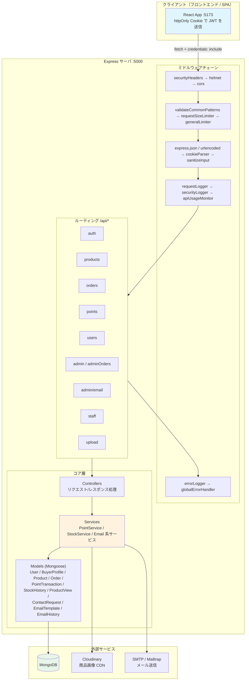
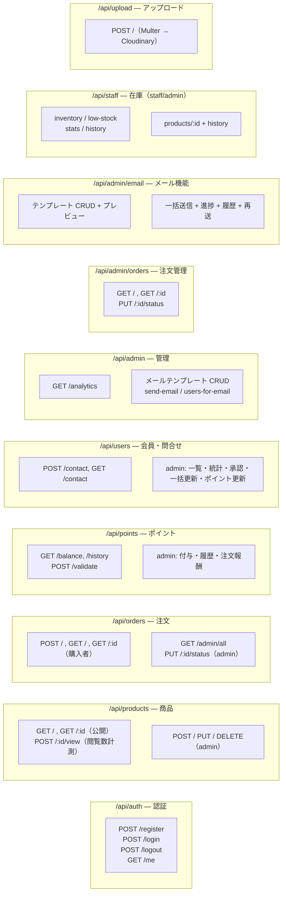
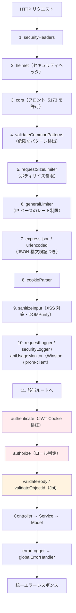
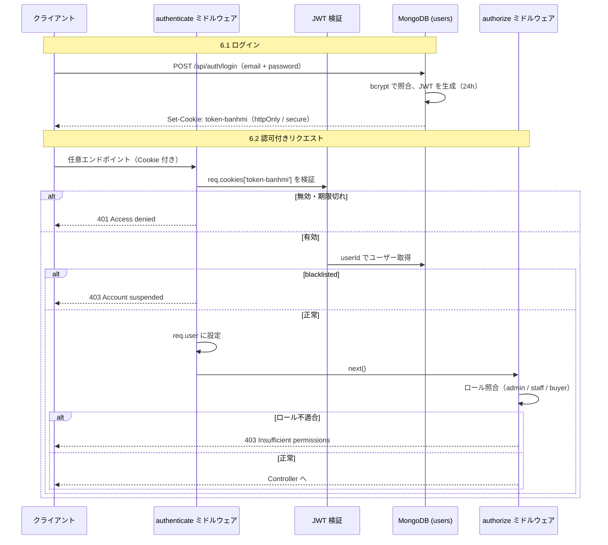
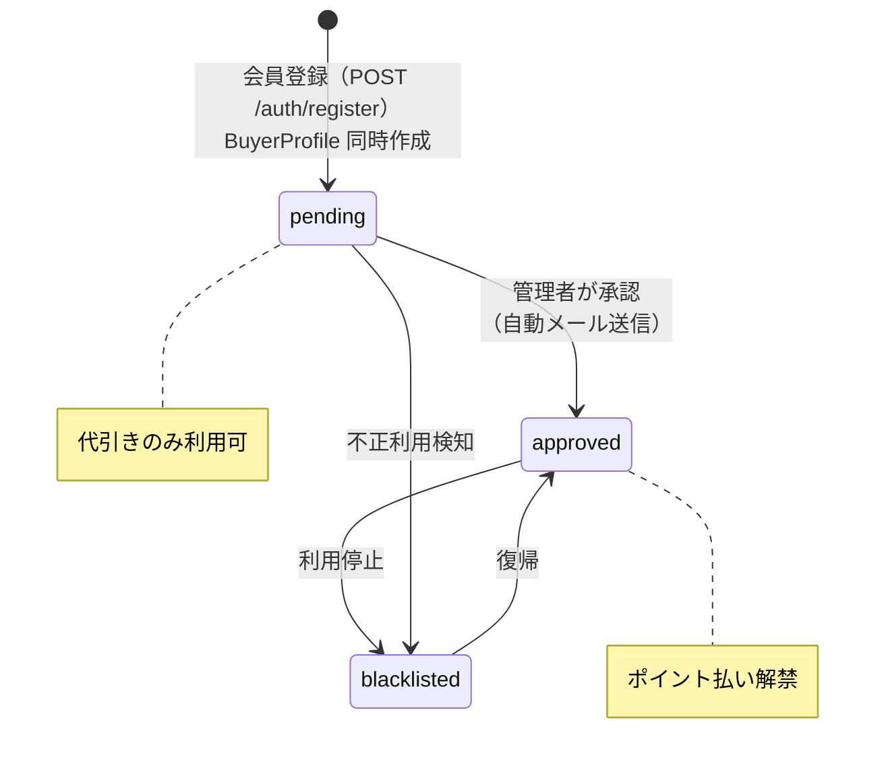
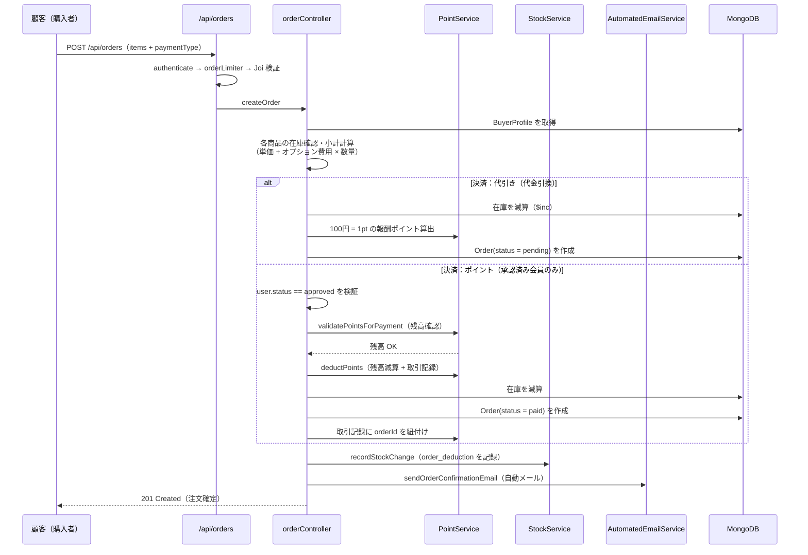
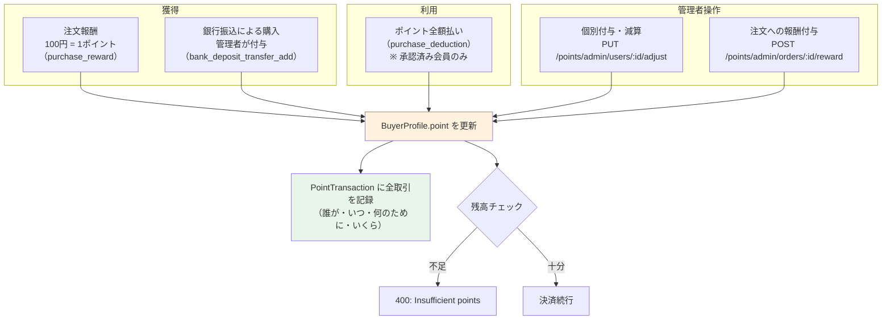
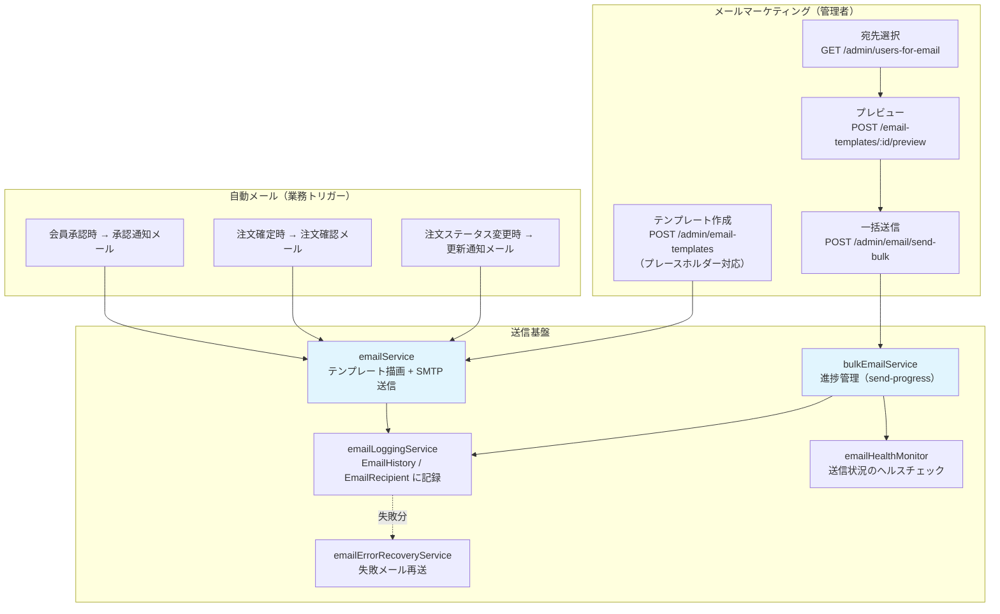
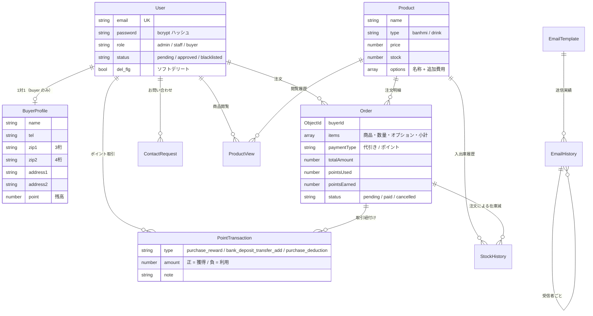

# BanhMi App — バックエンド API

ベトナムサンドイッチ（バンミ）と飲み物のオンライン注文サービスの **バックエンド（REST API）** です。
日本市場を想定した飲食配送ビジネスを支えるサーバサイドを **Express + TypeScript + MongoDB** で実装しています。

---

## 1. プロジェクト概要

| 項目 | 内容 |
| --- | --- |
| サービス名 | BanhMi App（バンミアプリ） |
| 想定市場 | 日本国内（日本語表記の決済手段・住所形式に対応） |
| 業種 | 飲食店のオンライン注文・配送サービス |
| 提供価値 | 顧客：かんたん注文とポイント還元／店舗：受注・在庫・会員・メールの一体管理 |
| 対象ユーザー | 一般顧客（購入者）／店舗スタッフ／管理者 |

### ビジネスの特徴（日本市場向け）

- **代引き（代金引換）** — 日本で最も一般的な決済手段を第一決済として実装
- **ポイント制度** — 100円ごとに1ポイント付与。承認済み会員は **ポイント全額払い** が可能
- **振込（銀行振込）によるポイント付与** — 顧客が銀行振込でポイントを購入し、管理者が付与する業務フロー
- **承認制の会員管理** — 登録直後は「承認待ち（pending）」。管理者の承認後でないとポイント払い不可（不正利用の防止）
- **日本の住所形式** — 郵便番号を「3桁＋4桁（例：〒112-0014）」に分割して登録
- **メールマーケティング** — 承認通知・注文確認などの自動メールに加え、テンプレートベースの一括送信に対応

---

## 2. 技術スタック

| 技術 | 用途 |
| --- | --- |
| Express 5 + TypeScript | Web フレームワーク / 型安全な API 実装 |
| MongoDB + Mongoose 8 | ドキュメント DB / ODM |
| JWT + bcryptjs | 認証（httpOnly Cookie + パスワードハッシュ） |
| Joi | リクエストボディのバリデーション |
| Helmet / CORS / express-rate-limit | セキュリティヘッダ・CORS・レート制限 |
| Multer + Cloudinary | 商品画像のアップロード・CDN 保存 |
| Nodemailer / Mailtrap | 自動メール・メールマーケティング送信 |
| Winston / Morgan / prom-client | ログ・アクセスログ・メトリクス |
| Jest + Supertest + mongodb-memory-server | 単体テスト・統合テスト（実 DB 不要） |

---

## 3. アーキテクチャ全体像



### ディレクトリ構成

```
backend/src/
├── index.ts            # サーバ起動（ミドルウェア順序を定義）
├── config/             # database / cloudinary / email / environment
├── controllers/        # 各 API のリクエスト処理
├── middleware/         # auth, validation, security, monitoring, errorHandler
├── models/             # Mongoose スキーマ（soft delete: del_flg）
├── routes/             # 10 モジュールのルーティング
├── services/           # 業務ロジック（point / stock / email 系 7 サービス）
├── scripts/            # メールテンプレート初期投入
├── types/              # 型定義
└── utils/              # バリデーション・テストユーティリティ
```

---

## 4. API ルート一覧



---

## 5. ミドルウェアチェーン（リクエスト処理順）



---

## 6. 認証・認可フロー



**会員ステータス遷移:**



---

## 7. 注文作成フロー（中核業務）



---

## 8. ポイントシステム



---

## 9. メールシステム



---

## 10. データモデル



**設計上のポイント:**
- すべてのモデルに **`del_flg`（ソフトデリート）** を実装し、物理削除を回避（監査・復旧性の確保）
- クエリミドルウェアで `del_flg` ドキュメントを自動除外
- 検索性能のためのインデックスを全モデルに定義（例：`Order.buyerId + createdAt`、`Product.type + del_flg`）

---

## 11. セキュリティ設計

| 対策 | 実装 |
| --- | --- |
| 認証 | JWT（24h）を **httpOnly / secure / sameSite** Cookie に格納。JS からアクセス不可（XSS 対策） |
| パスワード | bcrypt（コスト 12）でハッシュ化。API レスポンスでは自動除外 |
| XSS | DOMPurify による入力サニタイズ |
| CSRF/CORS | 許可ドメイン制限（フロントエンド :5173）、sameSite Cookie |
| レート制限 | 一般 / 認証 / 注文 / 管理者ごとに個別リミッタ（express-rate-limit） |
| 入力検証 | Joi スキーマ（ルート + コントローラの二段階）＋ ObjectId 検証 |
| 脆弱性パターン | リクエスト共通の危険パターン検出・ボディサイズ制限 |
| 監査ログ | Winston によるリクエスト/セキュリティ/エラーログ、prom-client によるメトリクス |

---

## 12. 開発コマンド

```bash
# 依存インストール
npm install

# 開発（nodemon + ts-node）
npm run dev

# 本番ビルド / 起動
npm run build:production
npm run start:production

# テスト
npm run test:unit           # 単体テスト
npm run test:integration    # 統合テスト（mongodb-memory-server）
npm run test:coverage       # カバレッジ

# 運用ユーティリティ
npm run create:admin        # 管理者ユーザー作成
npm run seed:email-templates # メールテンプレート初期投入
```

### 環境変数（`.env.example` 参照）

| 変数 | 用途 |
| --- | --- |
| `PORT` / `NODE_ENV` | サーバポート / 環境（development / staging / production） |
| `MONGODB_URI` | MongoDB 接続文字列 |
| `JWT_SECRET` / `JWT_EXPIRES_IN` | JWT 署名鍵 / 有効期限 |
| `CLOUDINARY_*` | 画像保存用 Cloudinary 認証情報 |
| `EMAIL_*` | SMTP / Mailtrap 送信設定 |

---

## 13. テスト戦略

- **単体テスト（unit）** — `__tests__/` 配下。コントローラ・ミドルウェアのロジックを検証
- **統合テスト（integration）** — `src/test/integration/` 配下。**mongodb-memory-server** を使い実 DB を起動せずに API 全体の結合を検証（Supertest）
- **スモークテスト** — `test:auth-api` `test:upload-complete` などの実 API 検証スクリプト

---

## 14. このプロジェクトの技術的ハイライト

採用担当・技術面接で確認いただきたいポイントです。

1. **堅牢な注文トランザクション処理** — 在庫引当・ポイント減算・注文作成・在庫履歴・確認メールを一連のフローとして実装。ポイント払いは二重支払いを防ぐ検証付き
2. **ポイントサービスの分離（PointService）** — 残高検証・加減算・取引履歴を単一サービスに集約し、再利用性とテスト容易性を確保
3. **多層セキュリティ** — レート制限（エンドポイント別）・入力サニタイズ・Joi バリデーション・httpOnly Cookie・blacklisted 拒否をミドルウェア層で段階的に適用
4. **メール基盤の設計** — 自動業務メール（承認・注文確認）とマーケティング一括送信を分離。進捗管理・失敗再送・ヘルスモニタリング・送信履歴まで実装
5. **ソフトデリート + インデックス設計** — 全モデル共通の `del_flg` とクエリミドルウェアによる自動除外、検索パターンに応じた複合インデックス
6. **監視・可観測性** — Winston 構造化ログ、API 利用監視、prom-client による Prometheus メトリクス対応
7. **本番品質のテスト** — mongodb-memory-server による統合テストで外部依存なしに API を検証
8. **日本のビジネス要件への適合** — 代引き決済、承認制会員、ポイント制度、振込付与、郵便番号形式など日本市場の業務フローをドメインモデルに反映
