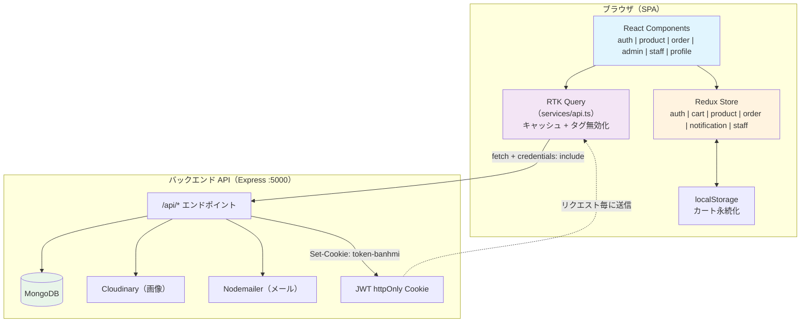
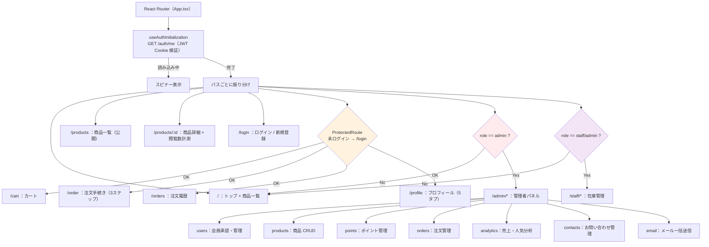
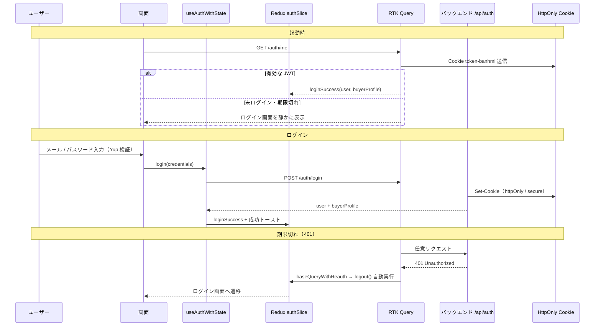
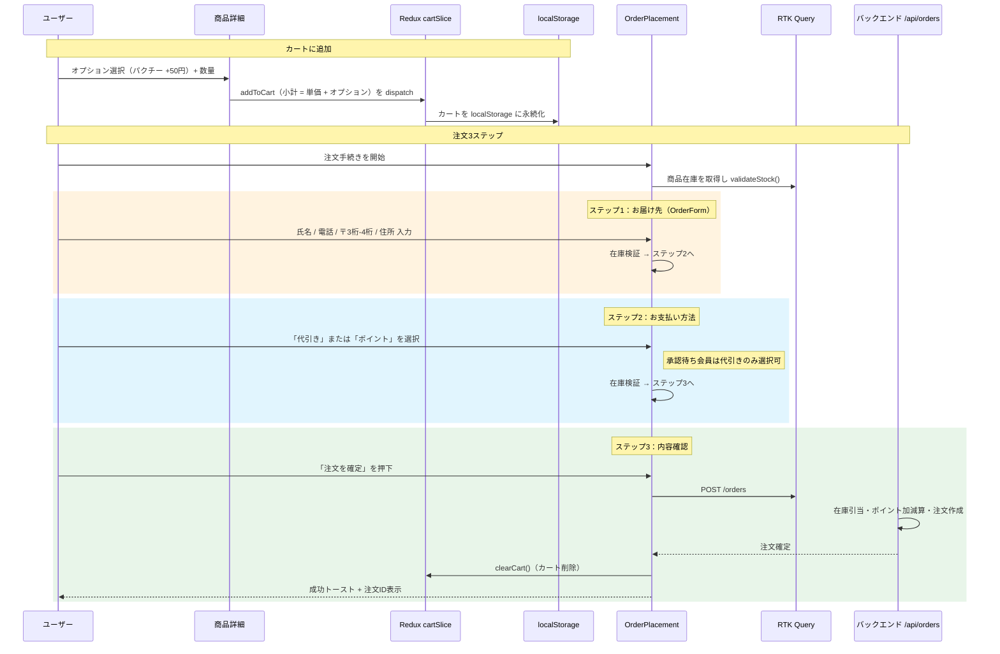
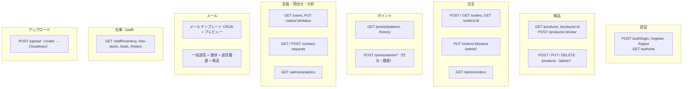
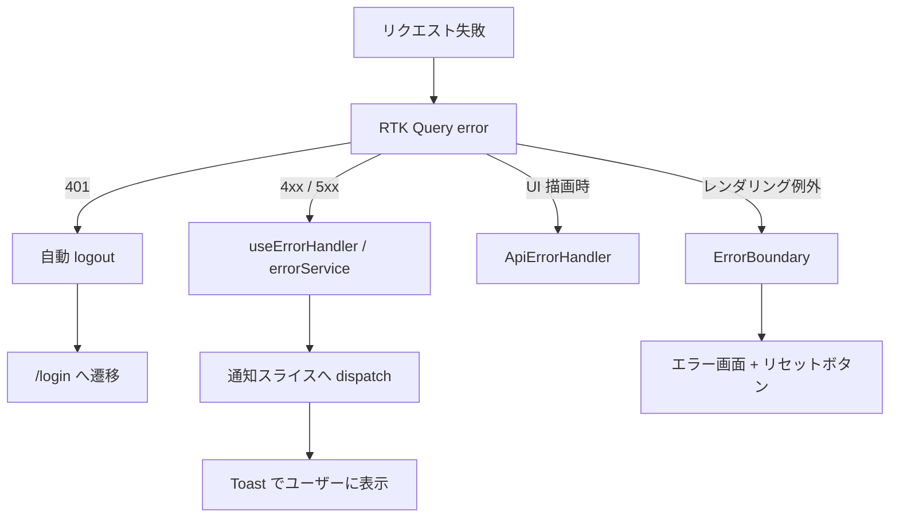

# BanhMi App — フロントエンド

ベトナムサンドイッチ（バンミ）と飲み物のオンライン注文アプリケーションの **フロントエンド** です。
日本市場を想定した B to C の食品配送サービスを想定し、React 19 + TypeScript で実装しています。

---

## 1. プロジェクト概要

| 項目 | 内容 |
| --- | --- |
| サービス名 | BanhMi App（バンミアプリ） |
| 想定市場 | 日本国内（日本語 UI・日本の住所形式に対応） |
| 業種 | 飲食店のオンライン注文・配送サービス |
| 対象ユーザー | 一般顧客（購入者）／店舗スタッフ／管理者 |
| 実装範囲 | 顧客注文フロー、会員管理、ポイント経営、メールマーケティング、在庫管理、売上分析 |

### ビジネスの特徴（日本市場向け）

- **日本語 UI** — ボタン・通知・ラベルはすべて日本語表記（例：「ご注文手続き」「管理者パネル」）
- **日本の住所形式** — 郵便番号を「〒112-0014」形式の **3桁＋4桁** に分割して入力
- **代引き（代金引換）対応** — 日本で一般的な COD 決済を第一の決済手段として実装
- **ポイント制度** — 100円ごとに1ポイントを付与し、満額ポイント払いが可能（会員承認後）
- **振込によるポイント付与** — 銀行振込（振込）を経由して店舗側がポイントを付与できる業務フロー
- **承認制の会員管理** — 登録後は「承認待ち」。管理者の承認後でないとポイント払いが利用不可（不正利用防止）

---

## 2. 技術スタック

| 技術 | バージョン | 用途 |
| --- | --- | --- |
| React | 19.1.1 | UI ライブラリ |
| TypeScript | ~5.8.3 | 型安全性の担保 |
| Vite | ^7.1.2 | ビルドツール / 開発サーバ |
| React Router DOM | ^7.8.2 | クライアントサイドルーティング |
| Redux Toolkit + RTK Query | ^2.9.0 | 状態管理 + API キャッシュ |
| React Hook Form + Yup | ^7.62.0 / ^1.7.0 | フォーム入力・バリデーション |
| Tailwind CSS | ^4.1.13 | スタイリング（レスポンシブ対応） |
| Tiptap | ^3.5.1 | メールテンプレート用リッチテキストエディタ |
| React Dropzone + Cloudinary | ^14.3.8 | 商品画像アップロード |
| DOMPurify | ^3.2.7 | XSS 対策（サニタイズ） |
| Vitest + React Testing Library | ^3.2.4 | ユニット／コンポーネントテスト |

---

## 3. アーキテクチャ



### ディレクトリ構成

```
frontend/src/
├── App.tsx              # ルート定義 + ProtectedRoute
├── main.tsx             # エントリポイント（Provider + Router）
├── components/
│   ├── admin/           # 管理者パネル（7管理機能 + メールモジュール）
│   │   └── email/       # テンプレート編集 / 一括送信 / 送信履歴
│   ├── auth/            # ログイン・登録、ProtectedRoute、ロール制御
│   ├── common/          # Layout / Header / Footer / Toast / ErrorBoundary
│   ├── order/           # カート、注文3ステップ、注文履歴
│   ├── product/         # 商品一覧・詳細・オプション
│   ├── profile/         # プロフィール、ポイント履歴、お問い合わせ
│   ├── staff/           # 在庫ダッシュボード、品切れアラート、入出庫履歴
│   └── examples/        # 各機能のデモコンポーネント
├── hooks/               # useAuthInitialization / useAddToCart / useCartPersistence ほか
├── services/
│   ├── api.ts           # RTK Query API（約50エンドポイント）
│   ├── apiHooks.ts      # useAuthWithState / useCreateOrderWithState ほか
│   ├── staffApiHooks.ts # 在庫系エンドポイント（injectEndpoints）
│   ├── uploadService.ts # Cloudinary アップロード
│   └── errorService.ts  # API エラー処理
├── store/               # auth / cart / product / order / notification / staff
├── types/               # 型定義一式
├── utils/               # Yup バリデーションスキーマ
└── test/                # Vitest セットアップ
```

---

## 4. ルーティングとロール制御



| ロール | 権限 |
| --- | --- |
| **buyer（購入者）** | 商品閲覧・カート・注文・ポイント履歴・お問い合わせ。登録直後は「承認待ち」で代引きのみ利用可 |
| **staff（スタッフ）** | 在庫一覧・品切れアラート・入出庫履ラート・入出庫履歴の閲覧 |
| **admin（管理者）** | 全機能：会員承認、商品管理、注文管理、ポイント付与、分析、メールマーケティング |

---

## 5. 主なユーザーフロー

### 5.1 認証フロー



### 5.2 注文フロー（カート → 3ステップ注文）



---

## 6. 主な機能一覧

### 顧客向け
- 商品一覧・詳細（パン／ドリンクの絞り込み、ページング）
- オプション付きカート（同一商品＋異なるオプションは別行として管理）
- 3ステップ注文（お届け先 → 決済 → 確認）／在庫は各ステップで再検証
- 代引き・ポイント払いの2決済手段
- 注文履歴、プロフィール、ポイント履歴、お問い合わせ

### 管理者向け
- **会員管理** — 承認待ち／承認済み／ blacklist の状態遷移、一括更新
- **商品管理** — CRUD＋画像アップロード（Cloudinary）
- **注文管理** — 状態更新（pending / paid / cancelled）
- **ポイント管理** — 個別付与・減算、注文に対する付与処理
- **分析ダッシュボード** — 注文数トップ商品、閲覧数トップ商品、会員統計（チャート不使用・カード/テーブルUI）
- **メールマーケティング** — テンプレート作成（Tiptap リッチテキスト＋プレースホルダー）、宛先選択、プレビュー、一括送信、進捗表示、送信履歴、失敗分の再送

### スタッフ向け
- 在庫ダッシュボード、統計、品切れアラート、入出庫履歴、商品別履履歴モーダル

---

## 7. API 通信（RTK Query）

- ベース URL：`VITE_API_URL`（既定 `http://localhost:5000/api`）
- 認証：httpOnly Cookie（`credentials: "include"`）で JWT を自動送信
- タグベースのキャッシュで、 mutation 後に関連データを自動再取得
  - 例：`createOrder` → `Order / Product（在庫） / PointTransaction` を無効化
- **401 自動ログアウト**：`baseQueryWithReauth` が 401 を検知すると即 `logout()` を dispatch



---

## 8. エラー処理



---

## 9. 開発コマンド

```bash
# 依存インストール
npm install

# 開発サーバ（HMR）
npm run dev

# 型チェック + 本番ビルド
npm run build

# ステージング / 本番ビルド
npm run build:staging
npm run build:production

# テスト
npm run test:run        # 一括実行
npm run test:ui         # Vitest UI
npm run test:coverage   # カバレッジ

# Lint
npm run lint
```

### 環境変数

| ファイル | 用途 |
| --- | --- |
| `.env.development` | ローカル開発 |
| `.env.staging` | ステージング |
| `.env.production` | 本番 |

主要な変数：`VITE_API_URL`（バックエンド API のベース URL）

---

## 10. テスト方針

- **Vitest** — ユニットテスト（store / hooks）
- **React Testing Library** — コンポーネント挙動テスト（LoginForm、Cart、PointHistory など）
- **jsdom** — DOM 環境シミュレーション
- カバレッジレポート対応（`npm run test:coverage`）

---

## 11. このプロジェクトの技術的ハイライト

採用担当・技術面接で確認いただきたいポイントです。

1. **RTK Query による API キャッシュ設計** — タグ無効化で注文後の在庫・ポイントを自動再取得。パフォーマンスと保守性を両立
2. **ロールベースのアクセス制御** — `ProtectedRoute` + `requiredRole` で buyer / staff / admin をルーティング層で分離
3. **JWT + httpOnly Cookie 認証** — XSS からトークンを守る設計、401 自動リカバリ（自動ログアウト）
4. **多段階フォームの入力検証** — React Hook Form + Yup、注文は各ステップで在庫を再検証する堅牢な設計
5. **状態管理の分離** — 認証・カート・通知などをスライスごとに整理、カートは localStorage で永続化
6. **本番品質のエラー処理** — ErrorBoundary、API エラーハンドラ、トースト通知の多層構造
7. **日本市場の業務要件への対応** — 代引き決済、〒XXX-XXXX 形式の住所、ポイント制度、承認制会員管理、日本語 UI
8. **テスト自動化** — Vitest + RTL によるユニット／コンポーネントテストの整備
9. **型安全なコードベース** — TypeScript strict 系設定、`types/` に API 応答を含む型を一元管理
